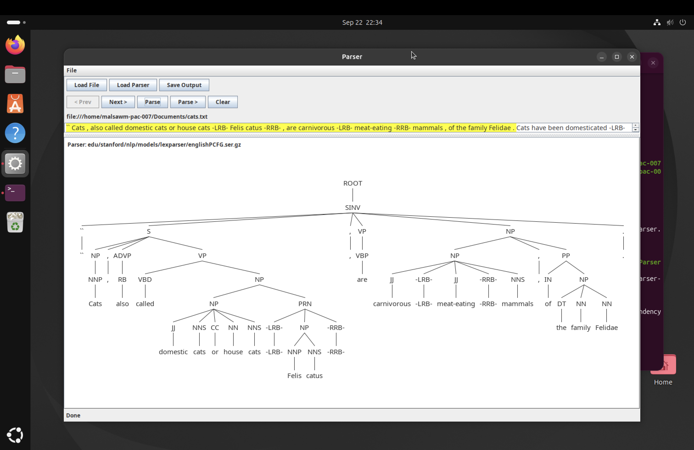
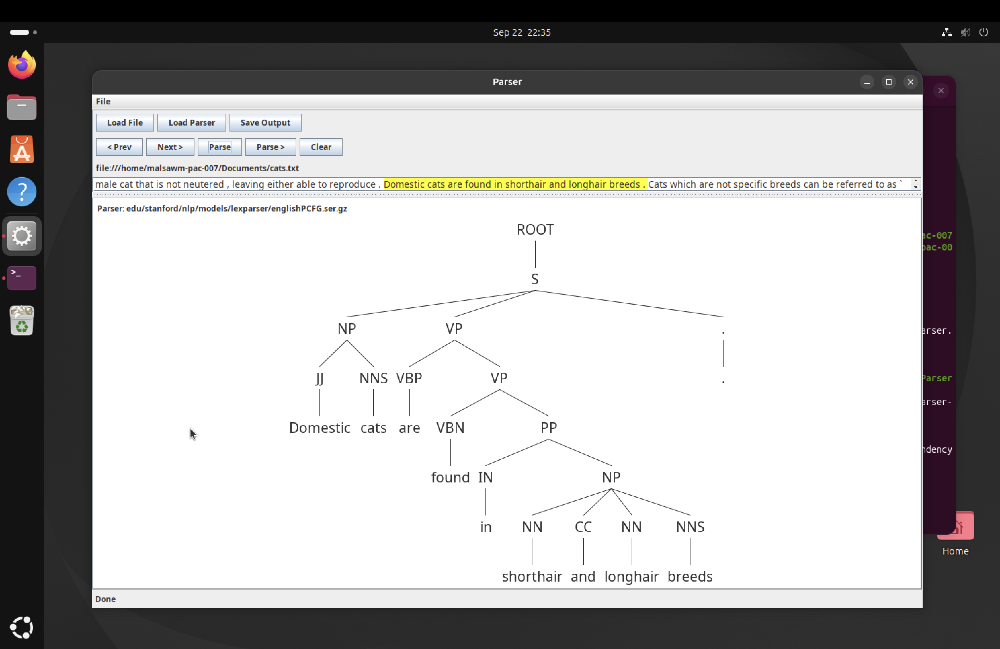

# Natural Language Analysis with the Stanford Parser

Lab 4 for **CSCI 4580/5580 – Data Science** (University of Colorado Denver, Fall 2026).

This project uses the **Stanford Parser** to break English sentences about cats into parse trees, then searches those trees in Python to pull out simple "facts", such as which sentences say what a cat *is*, *has*, or *is described as*.

**Author:** Malsawmdawngliana Pachuau

---

## What the project does

1. **Parse sentences into trees.** Sentences about cats from Simple English Wikipedia (`cats.txt`) are run through the Stanford Parser's English PCFG (Probabilistic Context-Free Grammar) model. Each sentence becomes a tree of parts of speech: noun phrases (NP), verb phrases (VP), nouns (NN), verbs (VBZ), adjectives (JJ), and so on.
2. **Compare two parse trees.** Two sentences are parsed in the parser's GUI (Graphical User Interface) and their tree structures are compared.
3. **Export every tree to XML.** The whole file is parsed to `cats.xml`: 213 sentences in the parser's `xmlTree` format.
4. **Search the trees in Python.** With `lxml` and XPath-style queries, the notebook finds sentences that match a pattern:
   - an **agent + action** pair, such as a noun phrase containing *cat* with a verb phrase containing *is* or *has*
   - an **agent + adjective** pair, such as *cat* or *cats* described as *brown*, *wild*, or *dry*

## Parse trees

| Sentence 1 | Sentence 2 |
|---|---|
|  |  |

Both sentences follow the same top-level pattern, a noun-phrase subject and a verb-phrase predicate, but differ inside:

- *are* (VBP) agrees with the plural *They*, while *is* (VBZ) agrees with the singular *a young cat*.
- *are* is a linking verb, while *is called* is passive voice, which appears as a VP nested inside another VP.
- Sentence 1 is deeper, because it attaches *in the world* to *pets*. The parser also has no way of knowing that *They* refers to cats.

## Example queries

Find sentences where a **cat** is the subject and the verb is **is**:

```python
agentact(sentence_node, 'cat', 'is')
```
```
A young cat is called a kitten .
```

Find sentences where **cat** or **cats** is described by the adjective **wild**:

```python
list(map(lambda nn: agentact2(nn[0][0][0], 'cat', 'wild'), root))
```
```
The big cats and wild cats are not tame , and can be very dangerous .
```

## Findings

- The same verb can carry different meanings: *has* appears in sentences with unrelated senses. A model can't rely on single words; it needs the surrounding context.
- With only ~200 sentences, many queries return just one or two matches. Learning which meaning applies in which context requires a large and varied dataset.
- Searching for both singular (`NN` → *cat*) and plural (`NNS` → *cats*) nouns noticeably increases the matches.

## Files

| File | Contents |
|---|---|
| `pachuau.malsawmdawngliana.ipynb` | The Jupyter notebook: setup notes, XML parsing, queries, and answers |
| `cats.txt` | Input text: sentences about cats from Simple English Wikipedia |
| `cats.xml` | Parser output: 213 sentences as XML parse trees |
| `tree1.png`, `tree2.png` | Parse tree screenshots from the Stanford Parser GUI |

## Tools

| Tool | Used for |
|---|---|
| Stanford Parser 3.4.1 (English PCFG model) | Parsing sentences, run in an Ubuntu virtual machine |
| Python 3 + `lxml` | Reading and searching the XML parse trees |
| Jupyter Notebook | Analysis and write-up |

## How to run

```bash
pip install lxml jupyter
jupyter notebook pachuau.malsawmdawngliana.ipynb
```

`cats.xml` is already included, so the Python part runs without installing the Stanford Parser. Regenerating `cats.xml` requires the parser (Java) and the `parsetoxml.sh` setup described in the notebook.

## Data source

Sentences from [Simple English Wikipedia](https://simple.wikipedia.org), "Cat" article.
